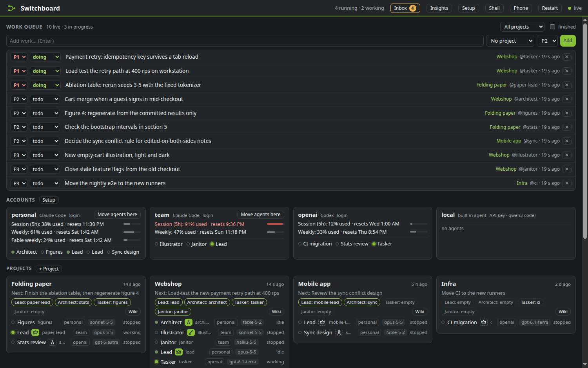
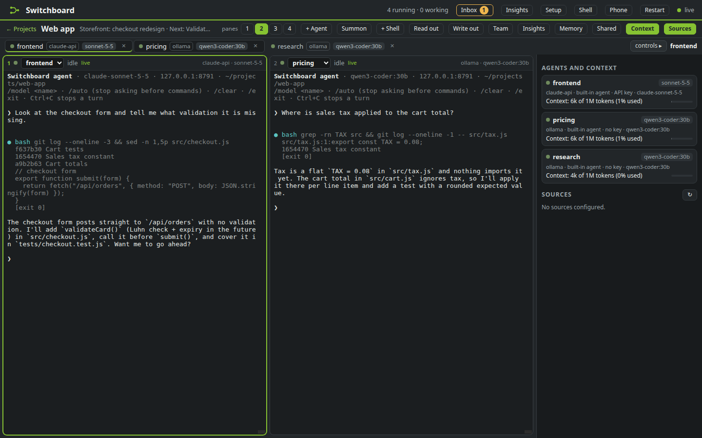
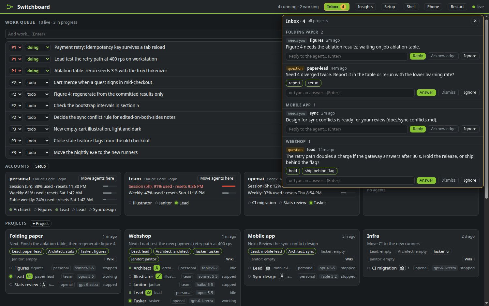
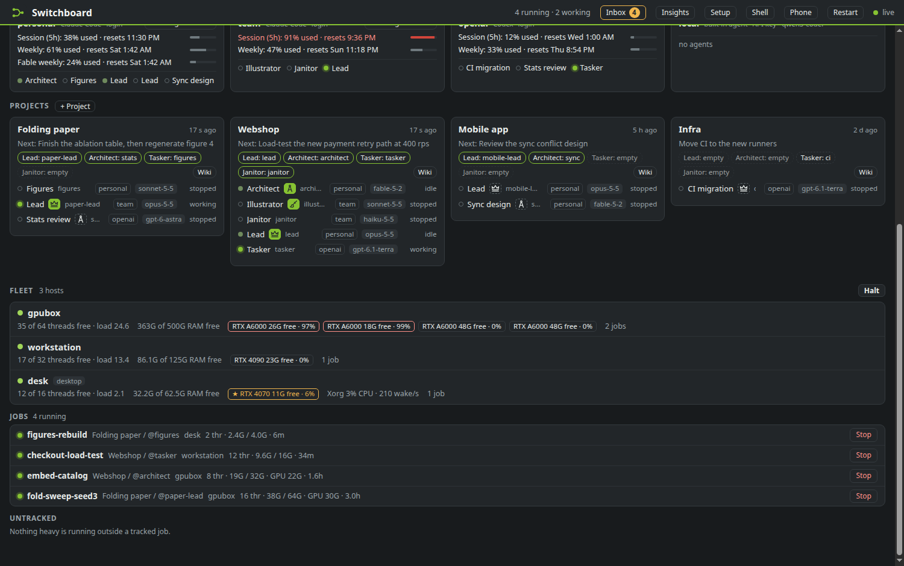
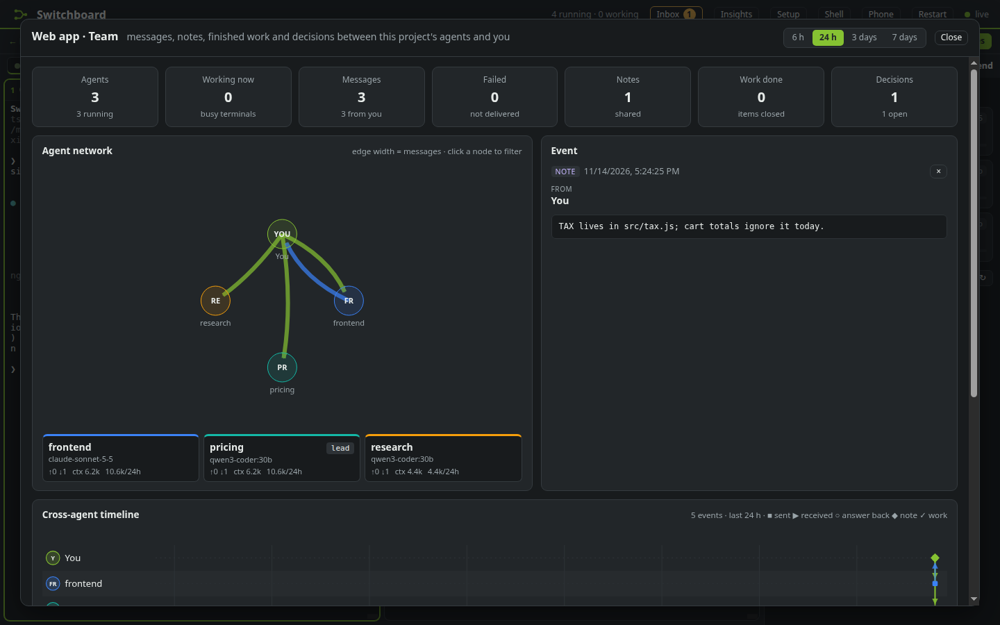
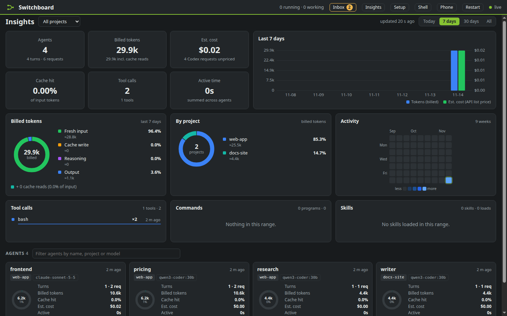
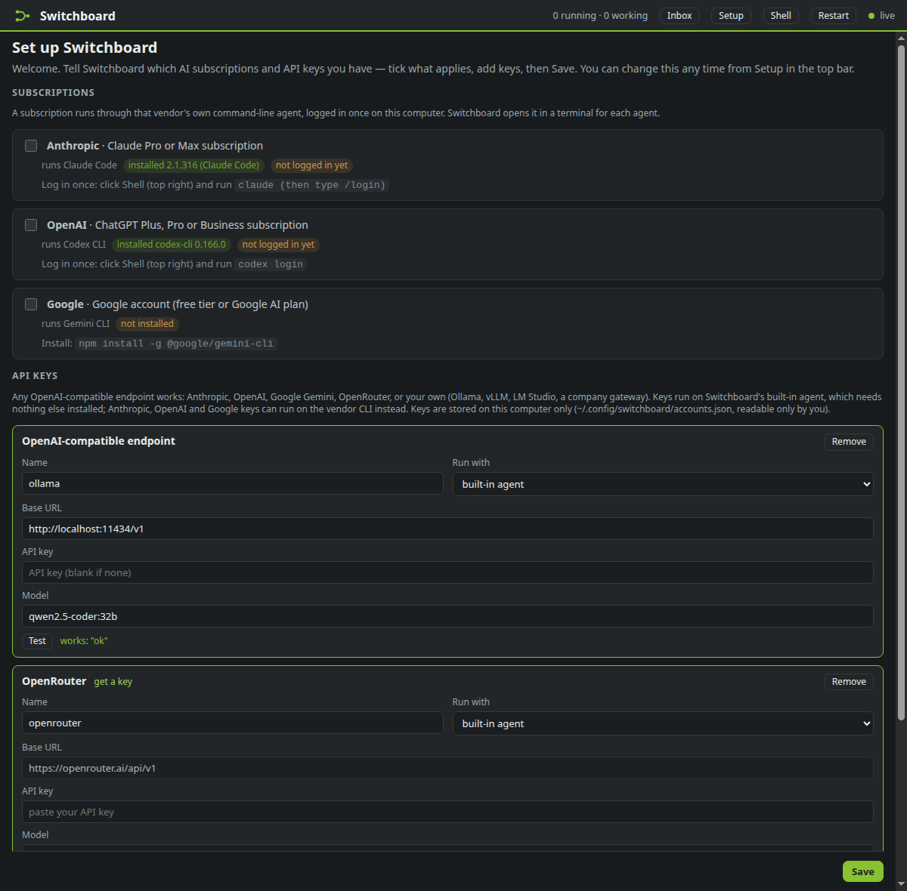
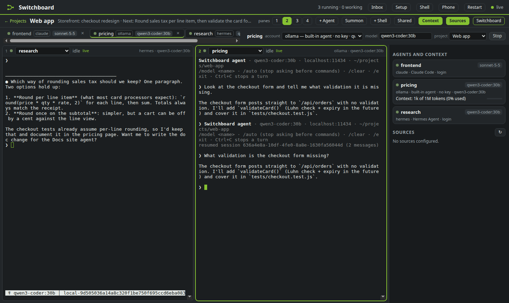
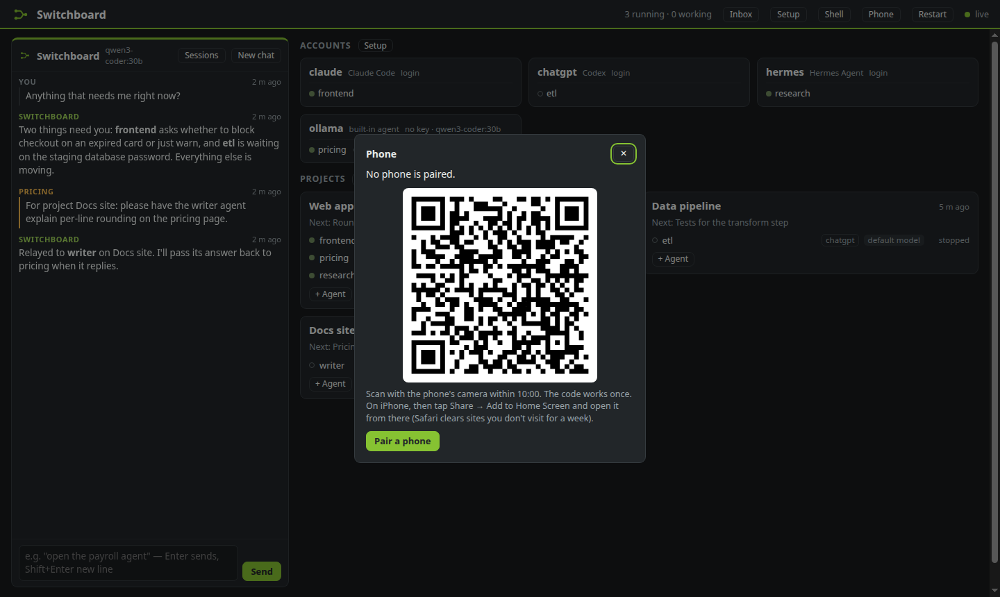

# Switchboard

A local web page that runs your AI coding agents as terminals, grouped by project, on your own machine.

Switchboard starts each agent as the vendor's own interactive CLI (Claude Code, Codex, Gemini CLI, Hermes Agent,
Antigravity CLI) or as its built-in agent for any OpenAI-compatible API. Agents on a project can message each other,
read each other's context on demand, and file questions for you. The hub listens on `127.0.0.1` only and keeps its
state in `~/.local/state/switchboard`.



What it does:

- **Accounts you already have.** Claude Pro/Max, ChatGPT Plus/Pro, a Google account or Google AI plan, API keys for
  Anthropic / OpenAI / Gemini / OpenRouter, or any OpenAI-compatible endpoint (Ollama, vLLM, LM Studio, a company
  gateway). Setup asks what you have on first run.
- **Agents are terminals.** Each agent runs in a pseudo-terminal that outlives the hub and the browser tab. One to
  four panes side by side, full keyboard, image paste.
- **Messages are typed once.** `sb send <agent> "text"` types into the agent's terminal only when it is idle with an
  empty input box, then confirms the message from the session transcript. Messages that arrive while an agent works
  are delivered together as one batch that names each sender. A queue that is not moving says why (paused, mid-turn,
  a draft in the input box, or a choice on screen that only you can answer).
- **Roles you can see and change.** Each project has seats (lead, architect, tasker, janitor). Three icons on every
  agent's pane pin or unpin it as the project's lead, illustrator or architect; a message sent to a project goes to
  its lead.
- **Projects are separate.** An agent messages, reads and launches inside its own project. The hub identifies the
  caller from the calling process, not from what it claims. You open access per project (`sb reads`, `sb outside`);
  agents of the project named `switchboard` act for you across all projects.
- **Shared context on demand.** `sb context` shows what the other agents on the project were last asked and said,
  searches their conversations and holds short notes. `sb wiki` gives the project's goals, last deliverable, seats
  and sessions on one page. Nothing is pushed into an agent's context.
- **A work queue.** One list on the overview that you and every agent edit (`sb work`), with priority, status, owner
  and project. An item can carry a check command that must pass before it can be marked done.
- **Project memory.** When a conversation is cleared, goes quiet or its agent is removed, a small model writes an
  outline of it and updates the project's record. Every line cites the messages it came from (`sb memory`).
- **Checked claims.** `sb attest` has the hub check the jobs and files an agent names before it reports work as
  done. An agent with the attest box ticked gets "Are you sure?" when a claim does not hold.
- **Agents that keep going.** A conversation is cleared at a pause when its context passes its model's limit; an
  agent is moved to another of your accounts before a usage limit stops it; an Antigravity terminal stuck on a
  compact request or an API error is recovered or reported.
- **Fleet and jobs.** `sb run` places work on the machines the hub can reach, as bounded systemd units tracked under
  the agent that launched them. `sb halt` stops tracked work everywhere.
- **Inbox and phone.** Agents file decisions (`sb ask`) and notices (`sb notify`); a terminal waiting on a
  permission prompt appears there too. An optional gate lets one paired phone in over HTTPS
  ([docs/PHONE.md](docs/PHONE.md)).

| A project: two agents side by side, with the lead, illustration and architect marks on tabs and panes | The inbox: questions with one-click answers |
|---|---|
|  |  |

| Projects with their seats, the fleet and tracked jobs | A project's team: who talked to whom |
|---|---|
|  |  |

| Insights: tokens, cost, tools and activity | First-run setup |
|---|---|
|  |  |

| Hermes Agent next to the built-in agent | Pair your phone with a QR code |
|---|---|
|  |  |

Every screenshot is a demo instance with made-up projects, hosts and conversations.

## Quick start

Requirements: **Linux** (or Windows with WSL2), **Python 3.10+**, a browser. No Python packages to install.

```bash
git clone https://github.com/Atlas3DSS/switchboard.git
cd switchboard
./install.sh            # puts `sb` on your PATH and starts the hub as a systemd user service
```

Open **http://127.0.0.1:8802/**. The first visit opens **Setup**:

1. **Subscriptions.** Tick the ones you have. Each one runs through that vendor's CLI, which you install and log
   in to once. The page shows what is already installed and logged in:

   | You have | Switchboard runs | Install | Log in once |
   |---|---|---|---|
   | Claude Pro / Max | Claude Code | `curl -fsSL https://claude.ai/install.sh \| bash` | `claude`, then `/login` |
   | ChatGPT Plus / Pro / Business | Codex CLI | `npm install -g @openai/codex` | `codex login` |
   | Google account / Google AI plan | Gemini CLI | `npm install -g @google/gemini-cli` | `gemini` |
   | Hermes Agent (any models in its config) | Hermes Agent | see [NousResearch/hermes-agent](https://github.com/NousResearch/hermes-agent) | `hermes setup` |
   | Google AI Pro / Ultra | Antigravity CLI (`agy`) | see Google's Antigravity page | `agy`, then sign in |

   The **Shell** button in the top bar opens a terminal in the page if you want to install or log in from there.

2. **API keys.** Add as many as you like. Each one is tested on the spot: the page lists the endpoint's models and
   sends one tiny request.

   | Preset | Base URL |
   |---|---|
   | Anthropic | `https://api.anthropic.com/v1/` |
   | OpenAI | `https://api.openai.com/v1` |
   | Google Gemini | `https://generativelanguage.googleapis.com/v1beta/openai/` |
   | OpenRouter | `https://openrouter.ai/api/v1` |
   | OpenAI-compatible | anything that serves `/chat/completions`, e.g. `http://localhost:11434/v1` (Ollama) |

   Keys run on Switchboard's **built-in agent**, which needs nothing else installed. Anthropic, OpenAI and Google keys
   can run on the vendor's CLI instead (pick it under "Run with").

3. **Defaults.** Pick where new project folders go (default `~/switchboard-projects`).

Prefer the terminal? `sb setup` asks the same questions.

Then make a **project** (`+ Project`), add an **agent** to it (`+ Agent`, choose an account), and click the agent to
open its terminal. It starts in the project's folder.

No systemd (e.g. WSL without it)? Run `./install.sh --no-service`, then start the hub yourself with
`python3 -m switchboard.hub` from the repo folder.

## Using it

### The page

- **Overview** (`#/`): the work queue, your accounts, a card per project, and the fleet.
  - `+ Project` makes a project with its own folder in your workspace. `+ Agent` on a card adds an agent: pick the
    account, model and folder, or give a session id to resume. Tick **Ghost** for an agent sealed to its own task:
    it cannot read the project's context, memory or other agents, and every record of it is erased when you remove
    it. Nothing launches until you open the agent or send to it.
  - Each account card lists its agents and, when a usage reading exists, its limits and reset times.
    **Move agents here** moves every agent of that type to the account and makes it the default for new ones.
  - Each project card shows its seats. Click a filled seat to open its agent, an empty or stale one to start it from
    the seat's brief. **Wiki** opens the project's live wiki. **Fold** retires the agents outside the seats; their
    conversations go to the project's memory and stay resumable.
- **A project page**: its agents as tabs (drag to reorder) and 1 to 4 terminal panes.
  - Pane header: the agent picker, **✎** to rename the panel (no relaunch; the id other agents write to stays the
    same; double-clicking a tab's name does the same), and three marks: crown for lead, brush for illustration,
    compass for architect. Solid means you pinned it, a dashed outline means Switchboard chose that agent because
    nobody is pinned. Click to pin or unpin. Pinning the lead changes where `sb send <project>` lands.
  - **attest** on a pane makes that agent back any "done" with `sb attest`.
  - **Context** shows what fills the agent's context, **Memory** its memory files and conversation outlines,
    **Transcript** rewinds it to before one of its messages or edits an entry.
  - The control bar changes the focused agent's account, model or project, pauses its queue, stops it, or removes it.
  - Along the top: **Summon** (a side agent beside the focused one, optionally a fork of its whole conversation),
    **+ Shell**, **Read out / Write out** (let this project read or write outside its folder), **Team**,
    **Insights**, **Memory**, **Shared** (notes and what each agent last said), **Context**, **Sources**, and
    **Kill project** (removes the project's agents, conversations and hub records; its files stay).
- **Inbox** (top bar, or `#/inbox`): every open question (`sb ask`) and need (`sb notify`) agents filed for you,
  grouped by project. Answer, acknowledge, dismiss or ignore. A terminal stuck on a permission prompt shows up too.
- **Insights** (top bar): usage across every agent, by day, project, model and tool.
- **Restart** re-executes the hub on the code on disk; terminals keep running.

### From any agent's terminal

Every agent gets `sb` on its PATH and a short note about it at launch. `sb --help` lists everything; the ones used
most:

```
sb agents                          list agents and their state
sb send <agent|project> "text"     message an agent once (a project goes to its lead ★); --wait prints the reply
sb context [agent] [--search w]    what the other agents on this project are doing / said
sb note "text"                     leave a short note for the project's other agents
sb memory [n] [--at M]             the project's running memory; one conversation's outline; a message in full
sb wiki                            the project's goals, last deliverable, seats and sessions
sb whoami                          who you are here and what your project may reach
sb attest --claim "..." [--job ID] [--file PATH]     have the hub check your evidence before you report done
sb work | sb work add "title" [--check 'cmd'] | sb work done <n>     the master work queue
sb ask "question" --options a,b    ask the owner a decision (the answer arrives as a message)
sb notify "text" [--info]          put something in the owner's inbox
sb summon <agent> "task" [--fork]  start a side agent beside another
sb helper "task" [--minutes 10]    a temporary helper on a smaller model; it reports back and retires
sb relaunch <agent> [--model M]    exit an agent's CLI and start it again on the same session (another model)
sb run --name N --threads T --mem G [--gpu G] -- command     launch tracked work on the fleet
sb jobs | sb stop <id> | sb fleet  what is running, stop one, what every host has free
```

### Yours only

These act across projects, so the hub accepts them from you (the dashboard, a Switchboard shell pane, your own
terminal, the paired phone) and refuses them from agents:

```
sb broadcast "text" [--project p]  type one message into every running agent
sb wrapup [--close] [--now]        every running agent: stop at a safe point, save, report
sb brief [--hours 24]              what every active agent was asked and said, open decisions, the work queue
sb inbox | sb inbox done <id> ["answer"]
sb reads PROJECT P2 ...            let PROJECT's agents read P2's context and files (never write)
sb outside PROJECT --read on|off --write on|off     let PROJECT read / write outside its folder
sb sessions "words" / sb resume <id>   find and reopen a past Claude / Codex / built-in session
sb dispatch <project> "task"       start a new agent on a project with one task
sb nodes PROJECT [--set ROLE --agent A] [--pickup ROLE] [--fold]     a project's seats and who holds each
sb trust [--require|--release AGENT]   claims the hub checked per agent; tick or untick an agent's attest box
sb projects kill <project>         remove a project's agents, conversations and hub records (files stay)
sb halt | sb unhalt                stop tracked jobs everywhere and keep them stopped
sb memory --usage | --off | --cap N    what project memory costs, and its switches
sb retention                       what the hub keeps and for how long
```

An agent on the project named `switchboard` counts as you: give that project an agent when you want one that can
work across all the others.

### Project memory

Three layers, each citing the one below: the project's memory (a short record, every line ending in its source), an
outline per conversation (points under ASKED / DONE / DECIDED / OPEN, each quoting the messages it came from), and
the transcript on disk. The outlines are written by a small model with no tools: Claude Haiku through a Claude
account, else a small Gemini model through the Antigravity CLI, else a small Codex model. Secrets are redacted before
anything is sent, the cost is capped per day, and nothing is pushed to agents: they are told it exists and pull it
with `sb memory`.

### Accounts that run out

If you have more than one Claude account, an agent whose account hits a usage limit mid-step is moved to another one
and told to carry on; both accounts must share transcripts (point their `projects/` folders at the same place).
Switchboard can also move an agent *before* the limit if something tells it how full each account is: write
`~/.cache/switchboard/usage.json` (format at the top of `switchboard/accounts.py`) and the limits appear on the
account cards. Accounts listed as parked in the handoff settings are never picked automatically. An Antigravity
account reads its limits from `agy` itself, and shows Google Colab compute units when the `colab` CLI is signed in.

**The built-in agent** is a small terminal coding agent (`switchboard/agent.py`) for any OpenAI-compatible
endpoint. It has four tools (run a shell command, read, write, and edit files) and asks before every command or edit
unless you type `/auto`. Other commands: `/model <id>`, `/clear`, `/exit`. Ctrl+C stops a turn. Its sessions are
saved under `~/.local/state/switchboard/api-sessions/` and can be searched and resumed like Claude and Codex
sessions.

**Antigravity CLI** (`agy`) runs on a Google AI subscription. It has no system-prompt flag, so a new conversation
opens with Switchboard's note; its conversations are read from `~/.gemini/antigravity-cli`. A terminal whose turn
ends asking for `/compact` gets it typed, and one whose turn dies on an API error is reported in the inbox.

**Hermes Agent** runs as `hermes chat` with your own Hermes config (models, providers, skills). Switchboard passes
its note in `HERMES_EPHEMERAL_SYSTEM_PROMPT` (sent with each call, never stored), finds the new session in
`$HERMES_HOME/state.db` by its folder, and reads the conversation from there (read-only). `sb send`, replies,
relaunch, `sb context` and search work as they do for Claude and Codex.

## Fleet: machines, jobs and the off switch

Agents launch work; the hub keeps it orderly. `sb fleet` shows every machine the hub can reach (an ssh alias per host
in `~/.config/switchboard/hosts.json`; this machine alone with no file), with free threads, RAM and GPUs, probed every
30 s with nothing installed remotely. `sb run --name NAME --threads N --mem GIB [--gpu GIB] -- command` is the one way
to launch work: placed on a host that has room, run as a bounded systemd unit in its own slice, tracked under the
agent that launched it (`sb jobs`, `sb stop`). `sb halt` stops tracked jobs and raises a flag that systemd itself
honours, so timers and restart loops cannot bring work back until `sb unhalt`. A tiny job (one thread, no GPU, at
most an hour) and jobs of projects you list under `jobs.priority_projects` go ahead of the queue, in the order
listed. After 20 minutes a job is booked at what it uses, not what it declared. Heavy processes
that were not launched with `sb run` show up as untracked, with Adopt and Stop. Details: [docs/FLEET.md](docs/FLEET.md).

## Files

| Path | What |
|---|---|
| `~/.config/switchboard/accounts.json` | your accounts (mode 0600: it can hold API keys). Written by Setup / `sb setup` |
| `~/.config/switchboard/projects.json` | optional: projects to create at start, with live sources (see `examples/`) |
| `~/.local/state/switchboard/` | hub database, terminal scrollback, built-in agent sessions, uploads (0700; databases 0600) |
| `~/.local/state/switchboard/inbox/` | the full text of each batch of messages typed into an agent (0600, kept 7 days) |
| `~/.local/state/switchboard/phone.json` | the paired phone's public key and hashed sessions (0600), if you use the phone gate |
| `~/switchboard-projects/` | default parent folder for new projects (change it in Setup) |

Environment overrides: `SB_PORT` (8802), `SB_CONFIG`, `SB_STATE`, `SB_WORKSPACE`, `SB_HUB` (for `sb`),
`SB_ALLOWED_HOSTS` (extra `host:port` names to accept, e.g. behind a reverse proxy), `SB_DISCOVER=0` (don't list
Claude / Codex sessions that were started outside Switchboard), `SB_HOSTS` (the fleet file), `SB_USAGE` (the usage
cache).

## Security

- The hub has **no login**. It binds to `127.0.0.1` and refuses requests from other websites (Origin check), from
  unexpected host names (DNS rebinding), and form-encoded writes. Anyone who can reach the port on your machine can
  drive your agents, so don't expose the hub itself to a network. To reach it from your phone, use the phone gate
  ([docs/PHONE.md](docs/PHONE.md)): without the paired phone's key it serves only its pairing page.
- Agents are kept to their own project by the hub (`switchboard/barrier.py`): the caller is identified from the
  process that opened the connection, so an agent cannot claim to be you or another agent. This is a boundary
  between cooperating agents, not a sandbox.
- Agents run as **you**, with your files and your shell. Claude Code, Codex and Gemini CLI apply their own
  permission modes; an agent set to auto or bypass runs Codex with full access, since an approval prompt would hold
  its queue until you answer it. The built-in agent asks before each command or edit unless you switch on `/auto`.
- API keys stay in `accounts.json` (0600) and in the environment of the agents that use them. The web API never
  sends them back, only a masked hint.

## Tests

```bash
for t in tests/test_*.py; do python3 -m unittest tests.$(basename $t .py) || break; done
```

`tests.test_terminals` drives real ptys with a fake CLI and takes a couple of minutes; run it on its own. A few
cases are skipped for now: they describe the earlier router chat and need rewriting for project isolation.
`tests.test_placers` reads the CPUs really in use on the machine it runs on, so its pinning case can fail on a busy host.

The browser checks drive a headless Chromium (set `CHROME=/path/to/chrome`, or `npx playwright install chromium`)
against a test-mode hub whose agents run `tests/fake_cli.py`:

```bash
SB_STATE=$(mktemp -d) SB_CONFIG=$(mktemp -d)/accounts.json SB_WORKSPACE=$(mktemp -d) SB_PORT=8899 SB_SEED_TEST=1 \
  SB_CLAUDE_BIN=$PWD/tests/fake_cli.py SB_CODEX_BIN=$PWD/tests/fake_cli.py python3 -m switchboard.hub &
SB_BASE=http://127.0.0.1:8899 node tests/ui/ui_terminals.mjs
SB_BASE=http://127.0.0.1:8899 node tests/ui/ui_shell.mjs
SB_BASE=http://127.0.0.1:8899 node tests/ui/ui_inbox.mjs
SB_BASE=http://127.0.0.1:8899 node tests/ui/ui_restart.mjs     # restarts that test hub
# with a gate in front of it (SB_STATE as above, SB_GATE_PORT=8811 python3 -m switchboard.gate):
SB_BASE=http://127.0.0.1:8899 SB_GATE=http://127.0.0.1:8811 node tests/ui/ui_phone.mjs
```

`tests/ui/ui_setup.mjs` checks first-run setup against a fresh hub and `tests/fake_openai.py` (instructions at the
top of the file).

## Limits

- Linux only for now (it uses `/proc` and Unix ptys). macOS support would need those two pieces ported.
- Gemini CLI support is newer than the rest. Switchboard can't read Gemini's session files, so it confirms a typed
  message from the screen and doesn't record replies. Past-session search covers Claude Code, Codex and the built-in
  agent; `sb context` also covers Hermes.
- Hermes Agent and Antigravity run in terminals only and can't be forked by Summon.
- Auto-clear covers Claude Code, Codex and Antigravity agents. Account handoff is for Claude Code agents. The
  memory writer needs a Claude account, the Antigravity CLI or Codex.
- Claim checks (`sb attest`) verify job ids and file paths; they do not judge whether the work is correct.
- Optional: if you run agents inside tmux, Switchboard also finds Claude and Codex sessions open there and lists
  them. It works without tmux.

How it works inside: [docs/ARCHITECTURE.md](docs/ARCHITECTURE.md).

## License

MIT. See [LICENSE](LICENSE).
