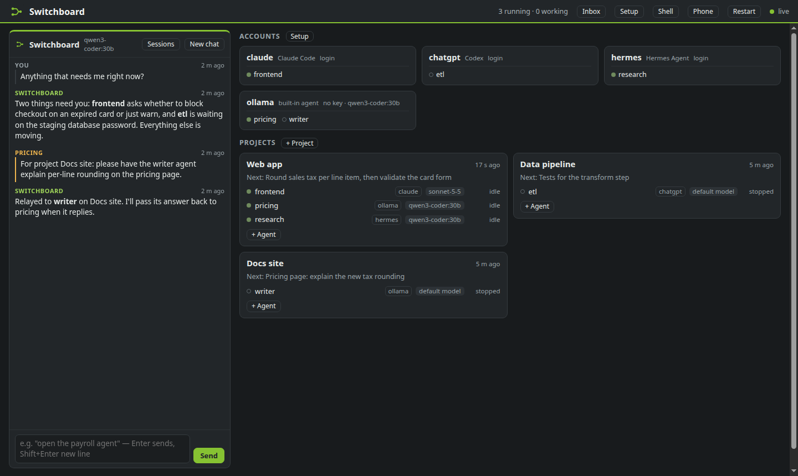
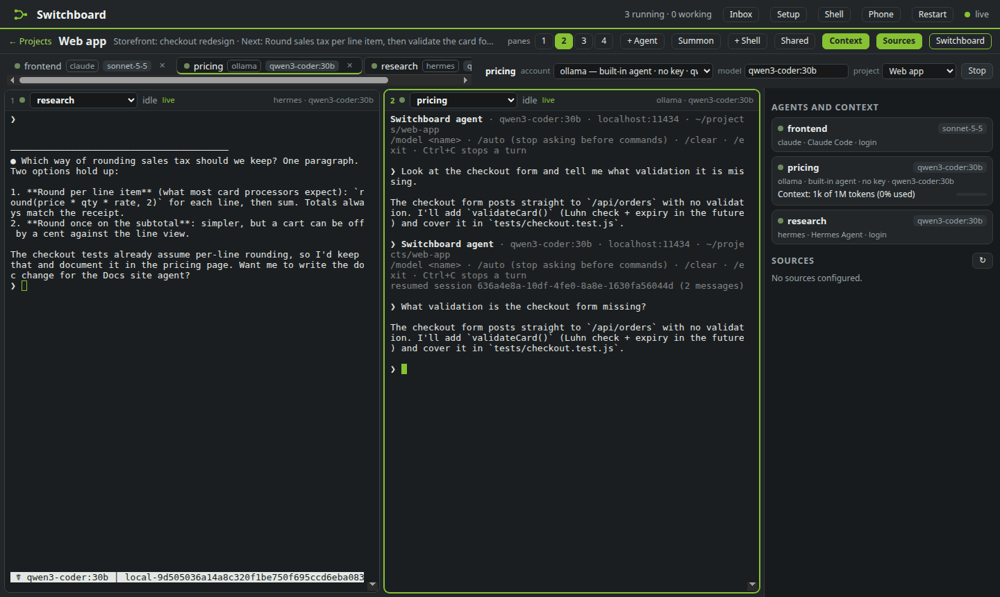
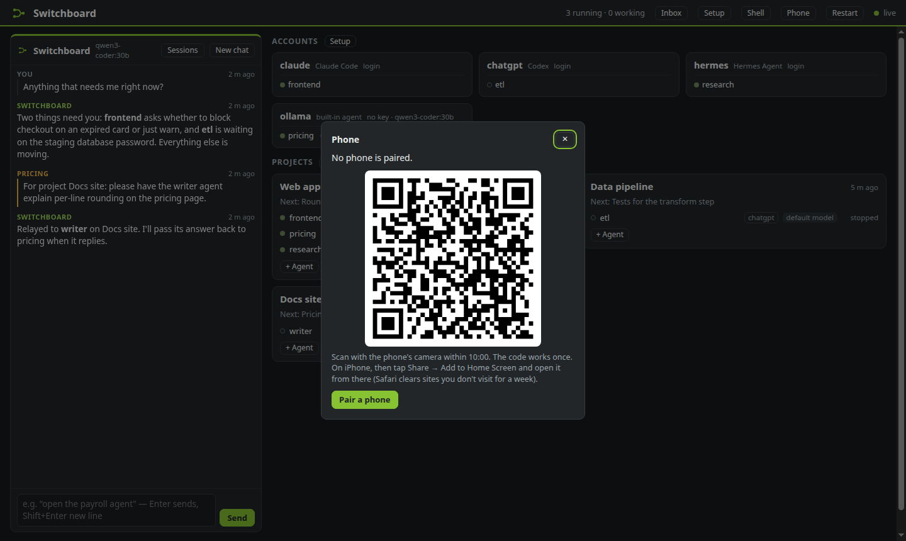
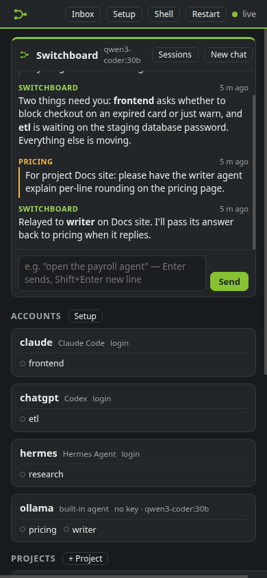
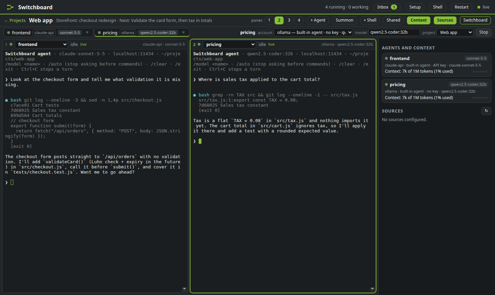
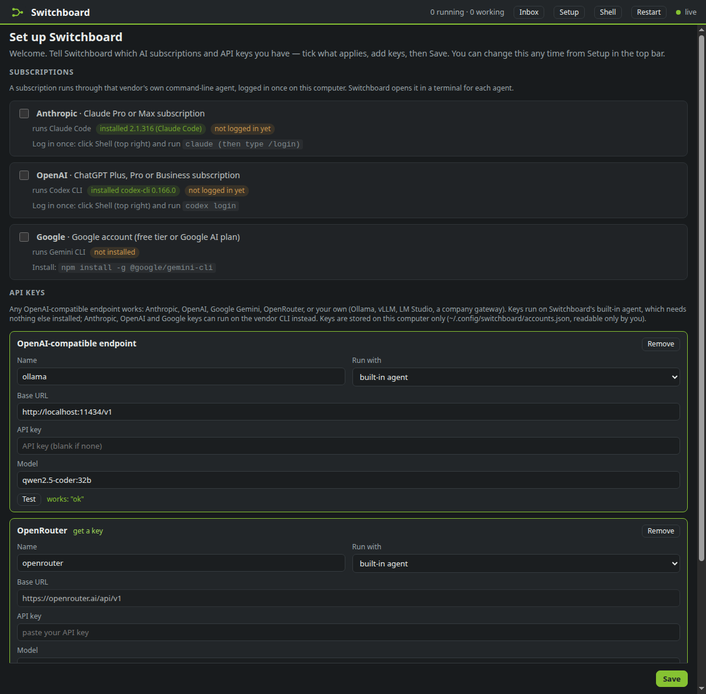
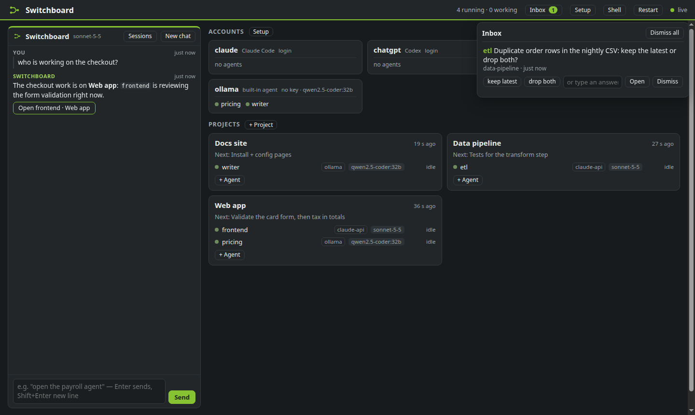

# Switchboard

**One local page for all your projects and all your AI coding agents.**

Switchboard runs your agents (Claude Code, Codex, Gemini CLI, Hermes Agent, or its own built-in agent for any
OpenAI-compatible API) as real terminals in your browser, grouped by project. Agents can message each other, read each other's
context on demand, and ask you questions without you juggling a dozen terminal tabs.



- **Bring the subscriptions and keys you already have.** Claude Pro/Max, ChatGPT Plus/Pro, a Google account,
  Anthropic / OpenAI / Gemini / OpenRouter API keys, or any OpenAI-compatible endpoint (Ollama, vLLM, LM Studio,
  a company gateway). A setup page asks what you have the first time you open it.
- **Agents are real terminals.** Each agent is the vendor's own interactive CLI (or the built-in agent) in a
  pseudo-terminal that outlives the hub and your browser tab. Up to four side by side, full keyboard, image paste.
- **Messages land exactly once.** `sb send <agent> "text"` types into that agent's terminal only when it's idle
  with an empty input box (background jobs it left running don't count), then confirms the message from the session
  transcript. It never types twice. Messages that arrive while an agent works go in together, as one batch that
  names each sender (every message in full in a private file), and if the oldest has waited 5 minutes the agent
  gets one Esc so the batch can land. A queue that doesn't move says why: paused, mid-turn, a draft in its input
  box, or a choice on screen that only you can answer (never answered for you).
- **Shared context, pulled on demand.** Agents on a project can run `sb context` to see what the others were
  last asked and said, search their conversations, and leave notes. Nothing gets pushed into anyone's context.
- **A chat that routes you.** The Switchboard chat (on whichever account you pick) opens the right agent, finds
  and resumes past sessions, starts side agents, relaunches an agent on another model, and tells you which agent
  spawned a subagent. Messages agents send it are labelled with the agent's name, not yours.
- **On your phone, and only your phone.** An optional gate lets exactly one paired phone in over HTTPS, through
  Tailscale or your own domain. Scan a QR code to pair; pairing another phone signs the old one out.
  [docs/PHONE.md](docs/PHONE.md)
- **An inbox for you.** Agents ask decisions (`sb ask`) and page you (`sb notify`). A terminal stuck on a
  permission prompt shows up there too.

Everything stays on your machine: the hub listens on `127.0.0.1` only and keeps its state in
`~/.local/state/switchboard`.

| Hermes Agent next to the built-in agent | Pair your phone with a QR code |
|---|---|
|  |  |

| On the paired phone | A project with two agents side by side |
|---|---|
|  |  |

| First-run setup | Agents ask you things in the Inbox |
|---|---|
|  |  |

## Quick start

Requirements: **Linux** (or Windows with WSL2), **Python 3.10+**, a browser. No Python packages to install.

```bash
git clone https://github.com/Atlas3DSS/switchboard.git
cd switchboard
./install.sh            # puts `sb` on your PATH and starts the hub as a systemd user service
```

Open **http://127.0.0.1:8802/**. The first visit opens **Setup**:

1. **Subscriptions.** Tick the ones you have. Each one runs through that vendor's CLI, which you install and log
   in to once. The page shows what is already installed and logged in:

   | You have | Switchboard runs | Install | Log in once |
   |---|---|---|---|
   | Claude Pro / Max | Claude Code | `curl -fsSL https://claude.ai/install.sh \| bash` | `claude`, then `/login` |
   | ChatGPT Plus / Pro / Business | Codex CLI | `npm install -g @openai/codex` | `codex login` |
   | Google account / Google AI plan | Gemini CLI | `npm install -g @google/gemini-cli` | `gemini` |
   | Hermes Agent (any models in its config) | Hermes Agent | see [NousResearch/hermes-agent](https://github.com/NousResearch/hermes-agent) | `hermes setup` |

   The **Shell** button in the top bar opens a terminal in the page if you want to install or log in from there.

2. **API keys.** Add as many as you like. Each one is tested on the spot: the page lists the endpoint's models and
   sends one tiny request.

   | Preset | Base URL |
   |---|---|
   | Anthropic | `https://api.anthropic.com/v1/` |
   | OpenAI | `https://api.openai.com/v1` |
   | Google Gemini | `https://generativelanguage.googleapis.com/v1beta/openai/` |
   | OpenRouter | `https://openrouter.ai/api/v1` |
   | OpenAI-compatible | anything that serves `/chat/completions`, e.g. `http://localhost:11434/v1` (Ollama) |

   Keys run on Switchboard's **built-in agent**, which needs nothing else installed. Anthropic, OpenAI and Google keys
   can run on the vendor's CLI instead (pick it under "Run with").

3. **Defaults.** Pick where new project folders go (default `~/switchboard-projects`) and which account the
   Switchboard chat uses.

Prefer the terminal? `sb setup` asks the same questions.

Then make a **project** (`+ Project`), add an **agent** to it (`+ Agent`, choose an account), and click the agent to
open its terminal. It starts in the project's folder.

No systemd (e.g. WSL without it)? Run `./install.sh --no-service`, then start the hub yourself with
`python3 -m switchboard.hub` from the repo folder.

## Using it

**The page.** On the left is the Switchboard chat; on the right, your accounts and project cards. A project page
shows its agents as tabs and 1–4 terminal panes. The control bar changes the focused agent's account, model or
project, stops it, or removes it. **Summon** starts a side agent next to the focused one, optionally as a fork of
its whole conversation.

**From any agent's terminal** (every agent gets `sb` on its PATH and a one-paragraph note about it):

```
sb agents                          list agents and their state
sb send <agent|project> "text"     message an agent once (a project goes to its lead ★); --wait prints the reply
sb context [agent] [--search w]    what the other agents on this project are doing / said
sb note "text"                     leave a short note for the project's other agents
sb ask "question" --options a,b    ask the owner a decision (answer arrives as a message)
sb notify "text" [--info]          put something in the owner's inbox
sb summon <agent> "task" [--fork]  start a side agent beside another
sb relaunch <agent> [--model M]    exit an agent's CLI and start it again on the same session (another model)
sb subagents [--model haiku]       recent Claude subagents and which agent spawned each
sb sessions "words" / sb resume <id>   find and reopen a past Claude / Codex / built-in session
sb dispatch <project> "task"       start a new agent on a project with one task (from scripts or other agents)
```

**The built-in agent** is a small terminal coding agent (`switchboard/agent.py`) for any OpenAI-compatible
endpoint. It has four tools (run a shell command, read, write, and edit files) and asks before every command or edit
unless you type `/auto`. Other commands: `/model <id>`, `/clear`, `/exit`. Ctrl+C stops a turn. Its sessions are
saved under `~/.local/state/switchboard/api-sessions/` and can be searched and resumed like Claude and Codex
sessions.

**Hermes Agent** runs as `hermes chat` with your own Hermes config (models, providers, skills). Switchboard passes
its note in `HERMES_EPHEMERAL_SYSTEM_PROMPT` (sent with each call, never stored), finds the new session in
`$HERMES_HOME/state.db` by its folder, and reads the conversation from there (read-only). `sb send`, replies,
relaunch, `sb context` and search work as they do for Claude and Codex.

## Fleet: machines, jobs and the off switch

Agents launch work; the hub keeps it orderly. `sb fleet` shows every machine the hub can reach (an ssh alias per host
in `~/.config/switchboard/hosts.json`; this machine alone with no file), with free threads, RAM and GPUs, probed every
30 s with nothing installed remotely. `sb run --name NAME --threads N --mem GIB [--gpu GIB] -- command` is the one way
to launch work: placed on a host that has room, run as a bounded systemd unit in its own slice, tracked under the
agent that launched it (`sb jobs`, `sb stop`). `sb halt` stops tracked jobs and raises a flag that systemd itself
honours, so timers and restart loops cannot bring work back until `sb unhalt`. Details: [docs/FLEET.md](docs/FLEET.md).

## Files

| Path | What |
|---|---|
| `~/.config/switchboard/accounts.json` | your accounts (mode 0600: it can hold API keys). Written by Setup / `sb setup` |
| `~/.config/switchboard/projects.json` | optional: projects to create at start, with live sources (see `examples/`) |
| `~/.local/state/switchboard/` | hub database, terminal scrollback, built-in agent sessions, uploads (0700; databases 0600) |
| `~/.local/state/switchboard/inbox/` | the full text of each batch of messages typed into an agent (0600, kept 7 days) |
| `~/.local/state/switchboard/phone.json` | the paired phone's public key and hashed sessions (0600), if you use the phone gate |
| `~/switchboard-projects/` | default parent folder for new projects (change it in Setup) |

Environment overrides: `SB_PORT` (8802), `SB_CONFIG`, `SB_STATE`, `SB_WORKSPACE`, `SB_HUB` (for `sb`),
`SB_ALLOWED_HOSTS` (extra `host:port` names to accept, e.g. behind a reverse proxy), `SB_DISCOVER=0` (don't list
Claude / Codex sessions that were started outside Switchboard).

## Security

- The hub has **no login**. It binds to `127.0.0.1` and refuses requests from other websites (Origin check), from
  unexpected host names (DNS rebinding), and form-encoded writes. Anyone who can reach the port on your machine can
  drive your agents, so don't expose the hub itself to a network. To reach it from your phone, use the phone gate
  ([docs/PHONE.md](docs/PHONE.md)): without the paired phone's key it serves only its pairing page.
- Agents run as **you**, with your files and your shell. Claude Code, Codex and Gemini CLI apply their own
  permission modes; an agent set to auto or bypass runs Codex with full access, since an approval prompt would hold
  its queue until you answer it. The built-in agent asks before each command or edit unless you switch on `/auto`.
- API keys stay in `accounts.json` (0600) and in the environment of the agents that use them. The web API never
  sends them back, only a masked hint.

## Tests

```bash
python3 -m unittest tests.test_core tests.test_sessions tests.test_shared tests.test_vtscreen tests.test_agent \
  tests.test_phone tests.test_hermes tests.test_boundary
python3 -m unittest tests.test_terminals      # real ptys with a fake CLI; ~1 minute
```

The browser checks drive a headless Chromium (set `CHROME=/path/to/chrome`, or `npx playwright install chromium`)
against a test-mode hub whose agents run `tests/fake_cli.py`:

```bash
SB_STATE=$(mktemp -d) SB_CONFIG=$(mktemp -d)/accounts.json SB_WORKSPACE=$(mktemp -d) SB_PORT=8899 SB_SEED_TEST=1 \
  SB_CLAUDE_BIN=$PWD/tests/fake_cli.py SB_CODEX_BIN=$PWD/tests/fake_cli.py python3 -m switchboard.hub &
SB_BASE=http://127.0.0.1:8899 SB_NO_DESK=1 node tests/ui/ui_terminals.mjs
SB_BASE=http://127.0.0.1:8899 node tests/ui/ui_shell.mjs
SB_BASE=http://127.0.0.1:8899 node tests/ui/ui_inbox.mjs
SB_BASE=http://127.0.0.1:8899 node tests/ui/ui_restart.mjs     # restarts that test hub
# with a gate in front of it (SB_STATE as above, SB_GATE_PORT=8811 python3 -m switchboard.gate):
SB_BASE=http://127.0.0.1:8899 SB_GATE=http://127.0.0.1:8811 node tests/ui/ui_phone.mjs
```

`tests/ui/ui_setup.mjs` checks first-run setup against a fresh hub and `tests/fake_openai.py` (instructions at the
top of the file).

## Limits

- Linux only for now (it uses `/proc` and Unix ptys). macOS support would need those two pieces ported.
- Gemini CLI support is newer than the rest. Switchboard can't read Gemini's session files, so it confirms a typed
  message from the screen and doesn't record replies. Past-session search covers Claude Code, Codex and the built-in
  agent; `sb context` also covers Hermes.
- Hermes Agent runs in terminals only (no headless Switchboard chat on it) and can't be forked by Summon.
- Optional: if you run agents inside tmux, Switchboard also finds Claude and Codex sessions open there and lists
  them. It works without tmux.

How it works inside: [docs/ARCHITECTURE.md](docs/ARCHITECTURE.md).

## License

MIT. See [LICENSE](LICENSE).
